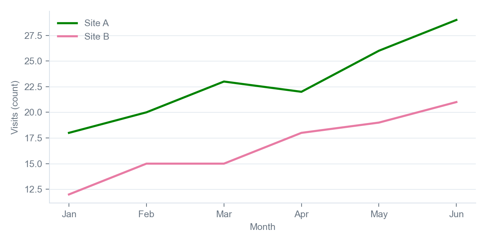

`NEUROMINE`

# Visit review

*Sample report with example numbers - 4 November 2026*

This sample shows each part of the Neuromine Markdown rules. The numbers are made up for the example and come from no release.

## 1. Summary

Both example sites kept most participants from screening to month 3. Site B lost fewer participants than Site A.

- Sites: Site A and Site B, both example sites
- Visits: screening and month 3
- Numbers: made up for this sample
  - Counts: participants seen at each visit
  - Change: month 3 against screening

> **Note:** A real report names the release every number comes from.

## 2. Counts by site

The table compares the two example sites across two visits.

**Table 1. Example visit counts by site**

| Site | Screening | Month 3 | Change |
| --- | ---: | ---: | ---: |
| Site A | 120 | 108 | -10% |
| Site B | 95 | 91 | -4% |
| Both sites | 215 | 199 | -7% |

Source: example numbers, not release data.

### What the table shows

Site A lost 12 participants between the two visits and Site B lost 4.

> **Key point:** Every number in a real document comes from a named release.

## 3. Trend

Visits at both example sites rose through the first half of the year.

**Figure 1. Example visits by month**



Source: example numbers, not release data.

**Table 2. Example visits by month**

| Month | Site A visits | Site B visits |
| --- | ---: | ---: |
| January | 18 | 12 |
| February | 20 | 15 |
| March | 23 | 15 |
| April | 22 | 18 |
| May | 26 | 19 |
| June | 29 | 21 |

The site coordinators said the same in the example survey.

> Booking the month 3 visit at screening kept people coming back.
>
> *Example site survey, June*

## 4. Method

The counts come from one query over an example visit table.

```sql
SELECT site, visit, COUNT(*) AS participants
FROM visits
GROUP BY site, visit;
```

To repeat the review for a real release:

1. Take the counts from the release index.
2. Name the release in each source line.
3. Run the checker on the file, as below.

```bash
python scripts/check_md.py neuromine-visit-review.md
```

> **Warning:** A count taken before the release is frozen can change.

## 5. Sources

- Layout rules for this report: [the Markdown rules](../references/markdown.md)
- The table above: [what the table shows](#what-the-table-shows)
